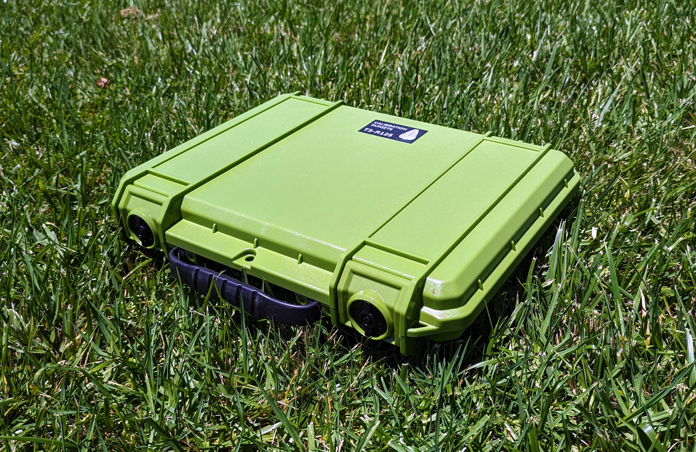

# Kalibreringsmål

MAPIR tilbyder forskellige kalibreringsmål til en bred vifte af anvendelsesområder. Den kompakte T4-R50, som ses nedenfor, indeholder 4 paneler, der er målt for lysrefleksion i området 250–2.500 nm.

<figure><figcaption>
MAPIR T4-R50
</figcaption></figure>T4-referencemålene med diffus refleksion har følgende reflektanskurver, [data kan downloades her](https://cdn.shopify.com/s/files/1/0972/5566/files/MAPIR_Diffuse_Reflectance_Standard_Calibration_Target_Data_T4.xlsx?v=1741759157):

<figure><figcaption>
MAPIR T4-refleksion :: 250–2.500 nm
</figcaption></figure>

<figure><figcaption>
MAPIR T4-refleksion :: 400–1.000 nm
</figcaption></figure>De diffuse T4P-referencemål har følgende reflektanskurver, [data kan downloades her](https://cdn.shopify.com/s/files/1/0972/5566/files/MAPIR_Diffuse_Reflectance_Standard_Calibration_Target_Data_T4.xlsx?v=1741759157):

<figure><figcaption>
MAPIR T4P-reflektans :: 250–2500 nm
</figcaption></figure>

<figure><figcaption>
MAPIR T4P-reflektans :: 400–1000 nm
</figcaption></figure>Når man ser på reflektansgrafen, kan man se, at værdierne er bølgelængde (x-aksen) mod reflektans i procent (y-aksen). Når vi tager et billede af kalibreringsmålet, opretter vi en sammenhæng mellem pixelværdi og reflektans i procent inden for det spektrum, som hvert af kameraets sensorbaner er følsomme over for.

Det betyder, at man til hvert billede, man tager med vores kameraer, kan bruge et foto af vores reflektansmål, såsom [T4-R50](https://www.mapir.camera/collections/calibration-targets/products/diffuse-reflectance-standard-calibration-target-package-t3-r50) eller [T4-R125](https://www.mapir.camera/collections/multispectral-reflectance-reference-calibration-targets/products/diffuse-reflectance-standard-calibration-target-package-t4-r125), til at kalibrere billederne med hensyn til reflektans. Når kalibreringen er udført, svarer hver pixel i billedet til en procentdel af reflektansen.

For **Survey3**-uddata gælder det, at hvis du eksporterer de kalibrerede billeder i Chloros som almindelige JPG- eller TIFF-filer, beregnes reflektansprocenten ved at dividere pixelværdien med billedformatets bitdybde. For JPG skal du altså dividere med 255, og for TIFF skal du dividere med 65.535. Du kan også vælge PERCENT-formatet som output i Chloros, og så vil hver pixel ligge i intervallet fra en procentværdi på 0,0 til 1,0 (0 % til 100 % reflektans). Vær blot opmærksom på, at nogle billedprogrammer ikke kan håndtere billeder i procent (flydende komma), og at de fylder meget på lageret.


**LATTICE-reflektans bruger en anden pixelskala.** LATTICE-reflektans gemmes med DN 32768 = 100 % reflektans (ikke 65535), og hver fil indeholder et XMP-tag (`Chloros:PixelScale`), der angiver dens skala. Læs tagget og divider med det i stedet for at antage en konstant — se [Output Image Formats](output-image-formats.md).


## Kalibreringsmål med LATTICE-kameraer

Med LATTICE-kameraer er et kalibreringsmål **valgfrit** for reflektans: Chloros kan i stedet basere reflektansen på den nedadgående strålingsintensitet, der måles af en DAQ-lyssensor (ρ = π·L/E). Referencen vælges via projektets indstilling for reflektanskilde, som angives med `chloros-cli process --reflectance-source` (brugergrænsefladen har ingen kontrol over dette og bruger projektets gemte værdi, som standard `auto` — se [Projektindstillinger](project-settings/project-settings.md)):

| Værdi | Adfærd |
| --- | --- |
| `auto` *(standard)* | Et QA-godkendt mål inden for rammen er den **absolutte reference**; når der ikke er noget mål til stede, eller QA mislykkes, falder Chloros tilbage til DAQ-nedstrålingsdelingen. Et mål, der består QA med en fejlmarkering (et panel, der er faldet ud, eller et bånd, der er ude af drift), foretrækkes ikke automatisk: kæderne »mål«, »mål+DAQ« og »kun DAQ« afprøves i rækkefølge efter deres målte score på de udeladte paneler. |
| `target` | Strengt mål-kun — ingen DAQ-erstatning. |
| `daq` | DAQ-autoritativ — nedadgående måling er altid referencen. |

Yderligere målopførsel for LATTICE:

* **Målgeometrier** — ArUco-mærkede paneler, paneler med fast ROI og strimmelmål understøttes alle; geometrien stammer fra projektets målkonfiguration.
* **Mål-reflektansscanninger pr. enhed** — `--target-reflectance-dir DIR` peger på et bibliotek med mål-reflektansscanninger pr. enhed (`<serial>.csv`, slået op via målenhedens serienummer/QR-kode). Ved en fejl falder Chloros tilbage til de nominelle T3/T4P-spektre.
* **Tidsmæssig forankring** — et detekteret mål kalibrerer de omgivende billeder og fastholdes mellem målopfangelser.

Fuldstændig flag-semantik og eksempler findes i [CLI-referencen](reference/cli-reference.md) (se "Eksporttogler pr. produkt").

### F988

»F988-reflektansen kalibreres ved hjælp af et reflektanspanel i scenen: båndet ligger uden for DAQ-lyssensorens kalibrerede område, så Chloros anvender din seneste paneloptagelse og fastholder den mellem panelobservationerne.«

Hvis F988 køres med en kalibrering, der udelukkende er baseret på DAQ, afviser Chloros den DAQ-baserede reflektans for det pågældende bånd og angiver årsagen (årsag til spring `dls-uncalibrated-band-988`); arbejdsgangen med panelet er den understøttede fremgangsmåde.

<figure><figcaption>
T4-R125
</figcaption></figure> <figure><figcaption>
T4-R125
</figcaption></figure> <figure><figcaption>
T4-R125
</figcaption></figure>

